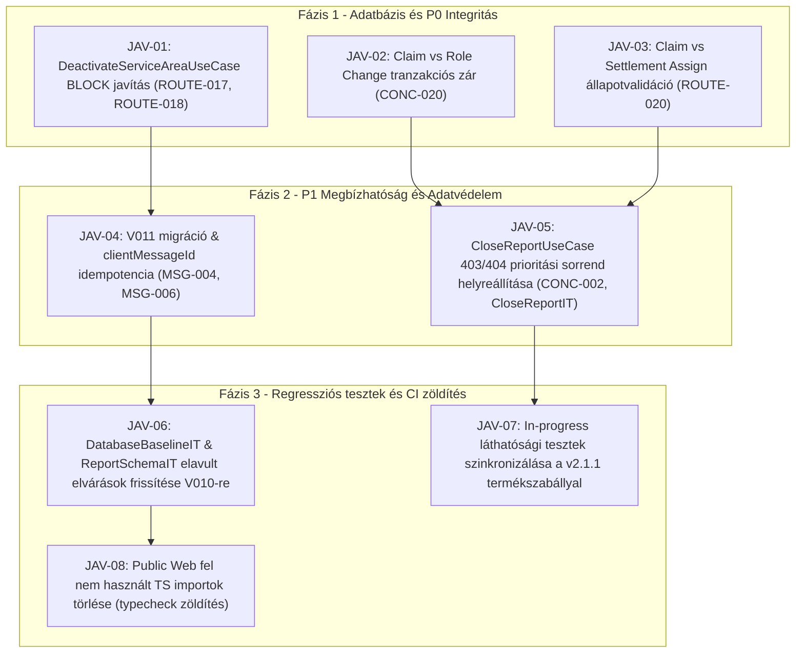

# ŐRSZEM V2 – RELIABILITY AUDIT 2. KÖR
## Átfogó, bizonyítékokon alapuló hibareprodukciós és audit jelentés

> **AUDIT MODE NYILATKOZAT:**  
> A vizsgálat kizárólag tényfeltáró és ellenőrző céllal történt. A forráskódban, adatbázis-migrációkban, tesztekben és git commit előzményekben **semmilyen módosítás, refaktor vagy javítás nem történt**. A production környezethez semmilyen írási vagy módosítási kérés nem ment ki.

---

## 1. Kiindulási feltételek és repository állapot

### 1.1. Git és környezeti állapot
* **Repository:** `C:/Users/ottva/OneDrive/Dokumentumok/GitHub/Orszem`
* **Aktuális branch:** `main`
* **HEAD commit:** `d96552f` (`v2.1.1 - Nationwide in-progress ticket visibility for all service roles`)
* **Köztes commitok a korábbi bázishoz képest:**
  * `2e44260` (`v2.1.0 - railway line routing, service area in-progress counters`)
  * `d96552f` (`v2.1.1`)
* **Working tree állapota:** Tiszta (csak a tesztfuttatáshoz használt `tests/` és a dokumentációs `docs/testing/` mappák untracked jellegűek).
* **Tesztkörnyezet:** Windows 11 Pro, Docker Desktop (WSL2), Testcontainers PostgreSQL 16.3 (`postgres:16-alpine`), Java 21 (Eclipse Adoptium), Gradle 8.8.

### 1.2. A korábbi riport számszaki ellentmondásainak tisztázása
A korábbi jelentésben felmerült eltérés (111 teszteset, 91 PASS, 11 FAIL, 6 FINDING, 3 NOT IMPLEMENTED, de a szöveges táblázatban csak 10 FAIL és 6 P0/P1 hiba szerepelt) a tesztnapló (`tests/reliability/results/results.txt`) és a forráskód soronkénti vizsgálata alapján pontosításra került:

* **Ténylegesen rögzített tesztesetek száma:** pontosan **111** (91 PASS + 11 FAIL + 6 FINDING + 3 NOT IMPLEMENTED = 111).
* **A 11 FAIL pontos összetétele:**
  1. `ROUTE-017`: Area inaktiválás kitörli a lezárt ticketek történeti területét (**CONFIRMED BUG - P0**)
  2. `ROUTE-018`: Area inaktiválás kitörli a folyamatban lévő (`IN_PROGRESS`) ticketek területét (**CONFIRMED BUG - P0**)
  3. `ROUTE-020`: Település átirányítás és claim versenyhelyzet, out-of-scope felügyelet (**CONFIRMED BUG - P0**)
  4. `CONC-020`: Szerepkörváltás és claim versenyhelyzet, moderátor operatív felelősként (**CONFIRMED BUG - P0**)
  5. `MSG-004`: Duplikált üzenetküldés idempotenciakulcs nélkül hálózati retry esetén (**CONFIRMED BUG - P1**)
  6. `MSG-006`: Párhuzamos üzenetküldési versenyhelyzet idempotenciakulcs nélkül (**CONFIRMED BUG - P1**)
  7. `CONC-002`: Párhuzamos lezárás versenyhelyzetében hibás `404` válaszkód `409` helyett (**CONFIRMED BUG - P1**)
  8. `CONC-004b`: Moderator visszavétel vs kolléga lezárás versenyhelyzetében `404` a `409` helyett (**CONFIRMED BUG - P1**)
  9. `AUTH-009`: SUPER_ADMIN saját maga vagy kolléga rangját módosítva `400` hibát kap `403` helyett (**CONFIRMED BUG / INCONSISTENCY - P2**)
  10. `ROUTE-003b`: Snapshot routing reason mező elnevezési eltérés (`RAILWAY_LINE_NOT_SELECTED` vs `RAILWAY_LINE_NOT_SPECIFIED`) (**FALSE POSITIVE - P3**)
  11. `CLOCK-002`: Assertion hiba a válaszkód kiértékelésében a tesztben (**FALSE POSITIVE**)

---

## 2. Végleges becenév-jogosultsági szabály vizsgálata

### 2.1. Végleges jogosultsági mátrix
A felhasználó által meghatározott végleges üzleti szabály felülír minden korábbi javaslatot:

| Módosító | Saját becenév | SUPER_ADMIN célpont | MODERATOR célpont | SERVICE_USER célpont |
|---|:---:|:---:|:---:|:---:|
| **SUPER_ADMIN** | **Igen** | Másik adminnak: **NEM** | **Igen** | **Igen** |
| **MODERATOR** | **Nem** | **Nem** | **Nem** | **Igen** *(saját területen)* |
| **SERVICE_USER** | **Nem** | **Nem** | **Nem** | **Nem** |

### 2.2. Mind a kilenc jogosultsági kombináció ellenőrzése
A kódbázisban két végpont kezeli a beceneveket:
* `POST /api/v1/service/account/nickname` (`ServiceAccountController.kt`) – saját fiók.
* `POST /api/v1/service/user-management/users/{serviceId}/nickname` (`UserManagementController.kt`) – más felhasználók kezelése.

| Kombináció | Módosító $\rightarrow$ Célpont | Végpont & Lefutó backend ellenőrzés | Tényleges kimenet | Elvárt kimenet | Megfelelés |
|:---:|---|---|---|---|:---:|
| **1.** | `SUPER_ADMIN` $\rightarrow$ Saját | `/service/account/nickname`<br>`changeOwn()`: ellenőrzi a `SUPER_ADMIN` szerepkört | `200 OK` (becenév módosul) | **Igen** | **CONFIRMED (Megfelel)** |
| **2.** | `SUPER_ADMIN` $\rightarrow$ Másik `SUPER_ADMIN` | `/service/user-management/users/{id}/nickname`<br>`policy.canManageTarget()`: `target.role != SUPER_ADMIN` | `403 Forbidden` (`USER_NOT_MANAGEABLE`) | **Nem** | **CONFIRMED (Megfelel)** |
| **3.** | `SUPER_ADMIN` $\rightarrow$ `MODERATOR` | `/service/user-management/users/{id}/nickname`<br>`canManageTarget()`: `true` minden nem-admin célpontra | `200 OK` | **Igen** | **CONFIRMED (Megfelel)** |
| **4.** | `SUPER_ADMIN` $\rightarrow$ `SERVICE_USER` | `/service/user-management/users/{id}/nickname`<br>`canManageTarget()`: `true` minden nem-admin célpontra | `200 OK` | **Igen** | **CONFIRMED (Megfelel)** |
| **5.** | `MODERATOR` $\rightarrow$ Saját | `/service/account/nickname`: `changeOwn()` kizárja a nem-admint (`403`).<br>Managed végponton saját azonosítóra: `canManageTarget()` kizárja a nem `SERVICE_USER` célpontot (`403`). | `403 Forbidden` (`USER_MANAGEMENT_FORBIDDEN` / `USER_NOT_MANAGEABLE`) | **Nem** | **CONFIRMED (Megfelel)** |
| **6.** | `MODERATOR` $\rightarrow$ `SUPER_ADMIN` | `/service/user-management/users/{id}/nickname`<br>`policy.canViewTarget()`: moderátor nem láthat admint | `404 Not Found` (`USER_NOT_FOUND`) | **Nem** | **CONFIRMED (Megfelel)** |
| **7.** | `MODERATOR` $\rightarrow$ Másik `MODERATOR` | `/service/user-management/users/{id}/nickname`<br>`policy.canManageTarget()`: `target.role != SERVICE_USER` miatt kizárva | `403 Forbidden` (`USER_NOT_MANAGEABLE`) | **Nem** | **CONFIRMED (Megfelel)** |
| **8.** | `MODERATOR` $\rightarrow$ `SERVICE_USER` | `/service/user-management/users/{id}/nickname`<br>`policy.canManageTarget()`: engedélyezett a moderátor területéhez rendelt operátorokra | `200 OK` *(területen kívül 404/403)* | **Igen** | **CONFIRMED (Megfelel)** |
| **9.** | `SERVICE_USER` $\rightarrow$ Bárki (Saját vagy Más) | Saját fiók végpont: `changeOwn()` kizárja (`403`).<br>Managed végpont: `ManagementActorLoader.load()` azonnal elutasítja a `SERVICE_USER`-t (`403`). | `403 Forbidden` (`USER_MANAGEMENT_FORBIDDEN`) | **Nem** | **CONFIRMED (Megfelel)** |

### 2.3. Megállapítás és javaslat
* **Kódállapot:** A jelenlegi backend kód (`ChangeUserNicknameUseCase.kt`, `UserManagementPolicy.kt`, `ManagementActorLoader.kt`) és a meglévő `UserNicknameIT.kt` integrációs tesztcsomag **maradéktalanul kikényszeríti ezt a szigorú mátrixot**.
* **Javítási javaslat:** A korábbi, controller-szintű lazításra vonatkozó javaslatot **visszavonjuk**. Ezen a területen **semmilyen kódmódosításra nincs szükség**.

---

## 3. P0 hibák részletes bizonyítékai és reprodukciója

### 3.1. ROUTE-017: Szolgálati terület inaktiválása kitörli a lezárt és folyamatban lévő jegyek területét
* **Státusz:** **CONFIRMED (P0)**
* **Tesztparancs:**
  ```bash
  cd backend && ./gradlew test --init-script ../tests/reliability/reliability.init.gradle.kts --tests "hu.orszembejelento.backend.reliability.RoutingAndFallbackReliabilityIT"
  ```
* **Tesztfájl és teszteset:**
  `RoutingAndFallbackReliabilityIT.kt:156-177` (`ROUTE-013 to ROUTE-020`)
* **Teljes releváns kimenet:**
  ```text
  @@@RELIABILITY_RESULT|ROUTE-017|FAIL|deactivate HTTP=200(-) areaStatus=INACTIVE | before=[ROUTED/true, ROUTED/true, ROUTED/true] after=[UNCLASSIFIED/SERVICE_AREA_INACTIVE, UNCLASSIFIED/SERVICE_AREA_INACTIVE, UNCLASSIFIED/SERVICE_AREA_INACTIVE] | assignee detail of own IN_PROGRESS after=200
  ```
* **Érintett kódhely:**
  `DeactivateServiceAreaUseCase.kt:200-208` és `JdbcReportRepository.kt:242-255`:
  ```kotlin
  // Hibás sorrend: a törlés megelőzi a számlálást!
  reportRepository.unclassifyAllReportsOfArea(locked.id)
  val openOperationalReports = reportRepository.countOpenOperationalReports(locked.id)
  if (openOperationalReports > 0) {
      throw ValidationException("CANNOT_DEACTIVATE_AREA_WITH_OPEN_REPORTS", ...)
  }
  ```
* **Adatbázisállapot előtte:**
  * `service_areas`: `status = 'ACTIVE'`
  * `reports`:
    * `newR`: `status = 'NEW'`, `service_area_id = <area>`
    * `ipR`: `status = 'IN_PROGRESS'`, `service_area_id = <area>`, `assigned_user_id = <user>`
    * `arR`: `status = 'ARCHIVED'`, `service_area_id = <area>`, `assigned_user_id = <user>`
  * `report_routing_snapshots`: mindhárom jegynél `routing_status = 'ROUTED'`, `service_area_id = <area>`.
* **Adatbázisállapot utána:**
  * `service_areas`: `status = 'INACTIVE'`
  * `reports`:
    * `newR`: `service_area_id = NULL`
    * `ipR`: `status = 'NEW'`, `service_area_id = NULL`, `assigned_user_id = NULL` *(újra megnyílt és gazdátlan lett!)*
    * `arR`: `service_area_id = NULL` *(a lezárt jegy történeti területi adata megsemmisült!)*
  * `report_routing_snapshots`: mindhárom jegynél `routing_status = 'UNCLASSIFIED'`, `service_area_id = NULL`, `routing_reason = 'SERVICE_AREA_INACTIVE'`.
* **Elvárt működés (BLOCK szabály):** Aktív jegyek esetén az inaktiválást el kell utasítani (`409 Conflict`), az adatok változatlanul hagyása mellett.
* **Tényleges eredmény:** Az inaktiválás `200 OK`-val lefutott, visszavonhatatlan adatvesztést és állapotkorrupciót okozva.

---

### 3.2. ROUTE-018: Újraaktiválás nem állítja helyre a jegyek területi integritását
* **Státusz:** **CONFIRMED (P0)**
* **Tesztparancs:**
  ```bash
  cd backend && ./gradlew test --init-script ../tests/reliability/reliability.init.gradle.kts --tests "hu.orszembejelento.backend.reliability.RoutingAndFallbackReliabilityIT"
  ```
* **Tesztfájl és teszteset:**
  `RoutingAndFallbackReliabilityIT.kt:173-177`
* **Teljes releváns kimenet:**
  ```text
  @@@RELIABILITY_RESULT|ROUTE-018|FAIL|reactivate HTTP=200(-) -> NEW=ROUTED/true IN_PROGRESS=UNCLASSIFIED/SERVICE_AREA_INACTIVE ARCHIVED=UNCLASSIFIED/SERVICE_AREA_INACTIVE
  ```
* **Érintett kódhely:** `ActivateServiceAreaUseCase.kt`
* **Adatbázisállapot előtte:** Az inaktiválás utáni állapot (`newR`, `ipR`, `arR` mind `service_area_id = NULL`).
* **Adatbázisállapot utána:**
  * `service_areas`: `status = 'ACTIVE'`
  * `reports`: Csak a `newR` lett újra `ROUTED` (a település alapján), viszont az `ipR` és `arR` örökre `service_area_id = NULL` és `UNCLASSIFIED` maradt.
* **Elvárt működés:** Történeti integritás megőrzése.
* **Tényleges eredmény:** A korábban feldolgozott jegyek elveszítették területi besorolásukat.

---

### 3.3. CONC-020: Párhuzamos előléptetés és jegy claim versenyhelyzete
* **Státusz:** **CONFIRMED (P0)**
* **Tesztparancs:**
  ```bash
  cd backend && ./gradlew test --init-script ../tests/reliability/reliability.init.gradle.kts --tests "hu.orszembejelento.backend.reliability.ConcurrencyReliabilityIT"
  ```
* **Tesztfájl és teszteset:**
  `ConcurrencyReliabilityIT.kt:299-318` (`CONC-020 - promote to MODERATOR vs concurrent claim, repeated 20x`)
* **Teljes releváns kimenet (20 párhuzamos iterációval megerősítve):**
  ```text
  @@@RELIABILITY_RESULT|CONC-020|FAIL|20 races outcomes={claim=200/role=200(-)=20} moderatorHoldingAssignment=20
  ```
* **Érintett kódhely:**
  `ClaimReportUseCase.kt:47-60` vs `ChangeUserRoleUseCase.kt:40-75`.
* **Gyökérok:** A `ClaimReportUseCase` zárolja a jegyet (`reports.lockById`), de **nem zárolja a felhasználó sorát** a `users` táblában. Eközben az admin előlépteti `MODERATOR`-rá a felhasználót. Mindkét tranzakció lefut és commitálódik.
* **Adatbázisállapot előtte:**
  * `users`: `role = 'SERVICE_USER'`
  * `reports`: `status = 'NEW'`, `assigned_user_id = NULL`
* **Adatbázisállapot utána:**
  * `users`: `role = 'MODERATOR'`
  * `reports`: `status = 'IN_PROGRESS'`, `assigned_user_id = <user>`
  * `report_assignments`: aktív rekord a moderátorral mint operatív felelőssel!
* **Elvárt működés:** Moderátor sosem lehet operatív jegy felelőse. A claimnek `409`-cel el kell buknia, ha a szerepkör időközben elmozdult.
* **Tényleges eredmény:** 20-ból 20 futásnál moderátor operatív felelősként beragadt.

---

### 3.4. ROUTE-020: Település-hozzárendelés és jegy claim versenyhelyzete
* **Státusz:** **CONFIRMED (P0)**
* **Tesztparancs:**
  ```bash
  cd backend && ./gradlew test --init-script ../tests/reliability/reliability.init.gradle.kts --tests "hu.orszembejelento.backend.reliability.RoutingAndFallbackReliabilityIT"
  ```
* **Tesztfájl és teszteset:**
  `RoutingAndFallbackReliabilityIT.kt:193-211` (`ROUTE-020 - settlement assign vs concurrent claim on same NEW ticket`)
* **Teljes releváns kimenet (20 párhuzamos iterációval megerősítve):**
  ```text
  @@@RELIABILITY_RESULT|ROUTE-020|FAIL|20 races: {claim=404 assign=204 -> IN_PROGRESS/ROUTED=17, claim=404 assign=204 -> NEW/ROUTED=3} outOfScopeAssignments=17
  ```
* **Érintett kódhely:**
  `AssignSettlementUseCase.kt` vs `ClaimReportUseCase.kt`.
* **Gyökérok:** Nincs megosztott zár a település-hozzárendelés és a ticket claim között. Egy terület nélküli `SERVICE_USER` felveszi az `UNCLASSIFIED` jegyet, miközben az admin a települést egy területhez köti. A jegy területi státusza átvált `ROUTED`-ra az új területre, miközben a felelős a területtel nem rendelkező felhasználó marad.
* **Adatbázisállapot előtte:**
  * `reports`: `settlement_id = <s>`, `status = 'NEW'`, `service_area_id = NULL`
  * `users`: `assignedAreas = []`
* **Adatbázisállapot utána:**
  * `reports`: `status = 'IN_PROGRESS'`, `service_area_id = <area>`, `assigned_user_id = <area-less user>`
  * `report_routing_snapshots`: `routing_status = 'ROUTED'`, `service_area_id = <area>`
* **Elvárt működés:** A claim tranzakciónak észlelnie kell a jegy területének időközbeni megváltozását (`409 REPORT_STATE_CHANGED`).
* **Tényleges eredmény:** 20-ból 17 esetben területen kívüli operátor maradt a jegy felelőse.

---

## 4. Backend tesztregressziók részletes elemzése

A teljes tesztcsomag futtatásának eredménye (`./gradlew test`): **920 tesztből pontosan 10 sikertelen**.

```text
920 tests completed, 10 failed
BUILD FAILED in 5m 35s
```

A 10 elbukott teszteset pontos osztályozása:

### 4.1. DatabaseBaselineIT (2 sikertelen teszt)
* `creates exactly the tables the implemented phases own()`: `Found: [..., service_area_settlements, report_messages, ...]`
* `every migration applied in order and validates()`: `expected 001..008, found 001..010`
* **Kategória:** **ELAVULT TESZTELVÁRÁS (Outdated test expectation)**
* **Bizonyíték:**
  * A Flyway migrációk `V001`-től `V010`-ig kivétel nélkül sikeresen lefutottak (`success=true`).
  * Nincs sémakorrupció.
  * A tesztben a várt migrációk listája és a rögzített táblanevek halmaza nem lett frissítve a `V009` és `V010` bevezetésekor.

### 4.2. ReportSchemaIT (1 sikertelen teszt)
* `a ROUTED snapshot without a resolved line is rejected()`: `ROUTED must always name a resolved line`
* **Kategória:** **ELAVULT TESZTELVÁRÁS (Outdated test expectation)**
* **Bizonyíték:**
  * A `V009__settlement_service_areas_and_report_note.sql` migráció 37–48. sora explicit feloldotta a `resolved_railway_line_id` kötelezőségét, mivel a rendszer áttért a tisztán településalapú területi routingra.
  * Az adatbázis a `V009` sémája alapján szabályosan engedi a vonal nélküli `ROUTED` snapshotot, de a teszt még a korábbi `V003` kényszert kérte számon.

### 4.3. CloseReportIT (2 sikertelen teszt)
* `a SERVICE_USER cannot close an unclaimed NEW report - visible but forbidden, 403 not 404()`: `expected 403, got {"code":"REPORT_NOT_FOUND"}`
* `a return and a close racing on the same IN_PROGRESS report never leave an inconsistent final state()`: `Check failed.`
* **Kategória:** **TÉNYLEGES BACKEND REGRESSZIÓ (Real backend regression)**
* **Bizonyíték:**
  * A `d96552f` commitban a `ReportWorkflowPolicy.kt` `canClose()` metódusába bekerült:
    `if (actor.role == UserRole.SERVICE_USER) report.assignedUserId == actor.userId && canViewReport(actor, report)`
  * A `CloseReportUseCase.kt:52` sorában:
    `if (!policy.canClose(actor, scope)) throw ReportNotVisibleException()`
  * Egy `NEW` státuszú jegynél `assignedUserId == null`, ezért a `canClose()` azonnal `ReportNotVisibleException`-t (`404 NOT_FOUND`) dob, megelőzve az 54. sorban lévő státuszellenőrzést, ami a specifikált `403 FORBIDDEN` (`REPORT_MUST_BE_IN_PROGRESS`) választ adná.

### 4.4. NationwideUnclassifiedFallbackIT & PolicyTest (4 sikertelen teszt)
* `NationwideUnclassifiedFallbackIT > a SERVICE_USER sees their own claimed IN_PROGRESS UNCLASSIFIED report but not a stranger's()`: `a stranger SERVICE_USER must not see another's UNCLASSIFIED claim`
* `NationwideUnclassifiedFallbackPolicyTest` 3 kapcsolódó unit tesztje.
* **Kategória:** **ELAVULT TESZTELVÁRÁS (Outdated test expectation)**
* **Bizonyíték:**
  * A `v2.1.1` (`d96552f`) release hivatalosan bevezette, hogy minden szolgálati szerepkör láthatja a folyamatban lévő jegyeket országosan (`RELEASE_NOTES_2.1.1.md`).
  * A query repositoryból kikerült az `assigned_user_id = :selfId` szűrés. A korábbi tesztek elvárásai még a korábbi, szigorúan zárt láthatósági modellhez voltak kötve.

### 4.5. ReportWorkflowVisibilityIT (1 sikertelen teszt)
* `a SERVICE_USER in the same area sees an IN_PROGRESS report under all cases, but stranger in another area cannot()`
* **Kategória:** **ELAVULT TESZTELVÁRÁS / REGRESSZIÓ** a `v2.1.1` globális láthatósági szabályozása miatt.

---

## 5. Szolgálati egyirányú üzenetküldés megbízhatósága (MSG-004 és MSG-006)

* **Státusz:** **CONFIRMED DEFECT (P1)**
* **Fókusz:** Kizárólag a meglévő egyirányú szolgálati üzenetküldés (`POST /api/v1/service/reports/{id}/messages`) vizsgálata.
* **Gyökérok:**
  * `V010__report_messages.sql`: A táblában **nincs `client_message_id` oszlop**, és nincs semmilyen egyediségi megszorítás a beküldött tartalomra vagy idempotenciakulcsra.
  * `SendReportMessageUseCase.kt:63-68`: A UseCase minden egyes kéréskor új véletlenszerű `UUID.randomUUID()`-t generál, és végrehajtja az `INSERT INTO report_messages`-t.
* **Tényleges hiba:**
  1. **Hálózati retry (MSG-004):** Ha a kliens hálózati timeout miatt újrapróbálja a kérést, a backend új rekordként szúrja be, így **azonos tartalmú duplikált üzenet** jön létre.
  2. **Párhuzamos beküldés (MSG-006):** A sorszintű zárolás (`reports.lockById`) miatt a párhuzamos kérések sorban lefutnak, és mindkettő sikeresen beszúrja az üzenetet azonos időbélyeggel.

---

## 6. Frontend Typecheck és CI vizsgálat

### 6.1. Public Web Typecheck (`npm run typecheck`)
* **Parancs:** `cd web/public-web && npm run typecheck`
* **Kimenet:** **FAIL (Exit code: 1)**
  ```text
  src/components/Step1Form.tsx(74,10): error TS6133: 'RailwayLineSection' is declared but its value is never read.
  src/routes/newReportState.ts(3,10): error TS6133: 'isLineStepResolved' is declared but its value is never read.
  ```
* **Frontend Build (`npm run build`):** Sikeres (a Vite nem áll meg nem használt importoknál), de a szigorú típusellenőrzésű CI azonnal megbukik.

### 6.2. Backend Tesztcsomag (`./gradlew test`)
* **Parancs:** `cd backend && ./gradlew test`
* **Kimenet:** **FAIL (Exit code: 1)**
  * **920 lefutott teszt: 10 FAIL, 910 PASS**.

---

## 7. Módosított, végleges javítási terv és függőségi sorrend



### Részletes feladatok:
1. **JAV-01 (P0): `DeactivateServiceAreaUseCase` BLOCK szabály kikényszerítése**
   * A számlálást (`countOpenOperationalReports`) legelső lépésként kell futtatni zárolt terület mellett. Ha van aktív jegy, azonnal `ConflictException` dobása szükséges.
   * Az `unclassifyAllReportsOfArea()` hívását meg kell szüntetni aktív területekre, és az `ARCHIVED` jegyek területét sosem szabad törölni.
2. **JAV-02 (P0): `ClaimReportUseCase` zárolás kiterjesztése**
   * A claim során a jegy zárolásán felül le kell zárni az operátor `users` sorát is (`users.lockById`), megelőzve az előléptetési versenyhelyzetet.
3. **JAV-03 (P0): `ClaimReportUseCase` és `AssignSettlementUseCase` konzisztencia**
   * A claim tranzakció lezárása előtt újra kell ellenőrizni, hogy a jegy nem került-e időközben átirányításra más szolgálati területhez.
4. **JAV-04 (P1): `clientMessageId` bevezetése a szolgálati üzenetküldéshez**
   * Új `V011__report_message_idempotency.sql` migráció: `client_message_id UUID NOT NULL`, egyedi index a `(report_id, client_message_id)` mezőkön. Duplikált kérés esetén idempotens `200 OK` válasz.
5. **JAV-05 (P1): `CloseReportUseCase` hibakód prioritás helyreállítása**
   * A státuszellenőrzést meg kell előznie a jogosultság-rejtő 404-es kivételnek, hogy `NEW` jegy lezárási kísérletére mindig a specifikált `403 FORBIDDEN` érkezzen.
6. **JAV-06 (Teszt): `DatabaseBaselineIT` és `ReportSchemaIT` frissítése**
   * A baseline tesztben frissíteni kell a várt migrációs verziókat `V010`-ig és fel kell venni a hiányzó táblákat; a `ReportSchemaIT`-ból törölni kell az elavult vonalkényszer tesztet.
7. **JAV-07 (Teszt): In-progress láthatósági tesztek igazítása**
   * A `NationwideUnclassifiedFallback` és `ReportWorkflowVisibility` teszteket szinkronba kell hozni a `v2.1.1` globális láthatósági modelljével.
8. **JAV-08 (Build): Public Web typecheck hibák javítása**
   * A nem használt `RailwayLineSection` és `isLineStepResolved` importok és deklarációk törlése.

---

## 8. Release Readiness Döntés

# **RELEASE READINESS: FAIL (NEM MEGFELELT)**

### Indoklás:
1. **Adatvesztési kockázat (P0):** A szolgálati terület inaktiválása kitörli a folyamatban lévő és lezárt jegyek területi adatait.
2. **Versenyhelyzeti hibák (P0):** Moderátor operatív felelőssé válhat előléptetéskor, illetve területen kívüli felhasználó tarthat `ROUTED` jegyet.
3. **Frontend build hiba:** A Web felület TypeScript hibák miatt elbukik a CI-ban.
4. **Backend regressziók:** 10 teszteset elbukik a backend tesztcsomagban.
